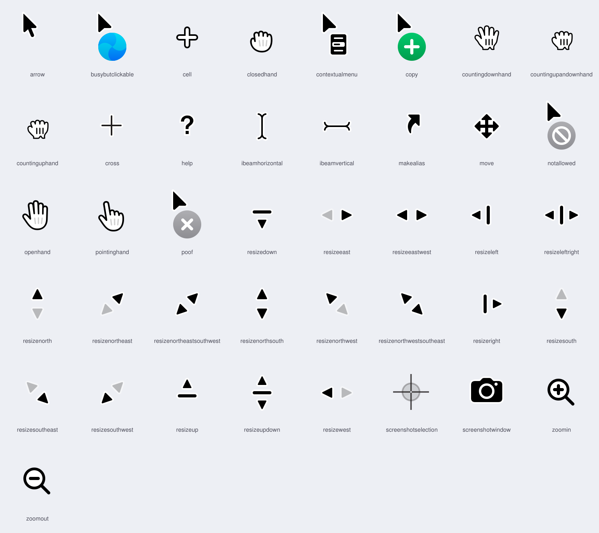

# macOS Cursors

The current macOS system cursors as clean SVG and PNG, extracted from macOS 27 (`26A428`).



Most "macOS cursor" packs online are traced from old bitmaps, so their edges wobble and they still show the pre-Tahoe shapes. These files are converted straight from the vector PDFs that ship inside macOS, without any retracing, so the geometry is exactly Apple's and stays sharp at any size.

## What's inside

| Path | Contents |
| --- | --- |
| `svg/` | One SVG per cursor at its native size in points |
| `png/` | `name.png`, `name@2x.png`, `name@4x.png`, rendered from the original PDFs |
| `cursors.json` | Size, click point (hotspot) and animation info for every cursor |
| `scripts/` | The extractor, to regenerate everything from your own Mac |

Animated cursors (`busybutclickable`, `countinguphand`, `countingdownhand`, `countingupandownhand`) are exported frame by frame: `busybutclickable-01.svg` … `busybutclickable-15.svg`. `cursors.json` lists their frame count and duration.

### Hotspots

The hotspot is the point that actually clicks, in points from the top-left corner of the cursor. Place the cursor so that this point sits on the pointer position:

```js
const { width, height, hotspot: [x, y] } = cursors.find((cursor) => cursor.name === "pointinghand");
image.style.left = `${pointerX - x}px`;
image.style.top = `${pointerY - y}px`;
```

### Notes

- Sizes are in points, as macOS draws them. A 28 × 40 cursor includes the empty margin macOS keeps for the shadow.
- macOS adds a soft drop shadow at runtime. It is not part of the artwork, so these files have none.
- The one-direction resize cursors (`resizeeast`, `resizenorth`, …) show the blocked direction as a dimmed arrow. That is how macOS draws them.
- The arrow is not in the regular cursor folder; it comes from the Accessibility cursors, which macOS uses when you change the pointer colors.
- The spinning beachball is not stored as a vector in macOS, so it is not included.

## Regenerate

Requires macOS and Python 3.9+.

```sh
python3 -m venv .venv
.venv/bin/pip install -r requirements.txt
.venv/bin/python scripts/extract.py
```

The script reads the cursors from:

- `/System/Library/Frameworks/ApplicationServices.framework/.../HIServices.framework/.../Resources/cursors`
- `/System/Library/PrivateFrameworks/AccessibilitySupport.framework/.../AccessibilityFoundation.framework/.../Resources/Cursors-macOS16` (arrow)

Re-run it after a macOS update to pick up new artwork.

## License

The extraction scripts are MIT licensed, see [LICENSE](LICENSE).

The cursor artwork is the property of Apple Inc. It is provided here for reference, design mockups and screen-recording tools that recreate the system pointer. This project is not affiliated with or endorsed by Apple. macOS is a trademark of Apple Inc.
